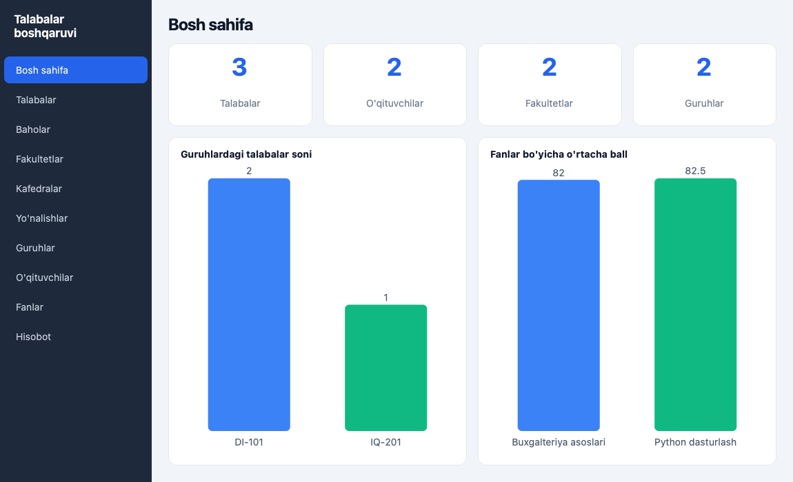
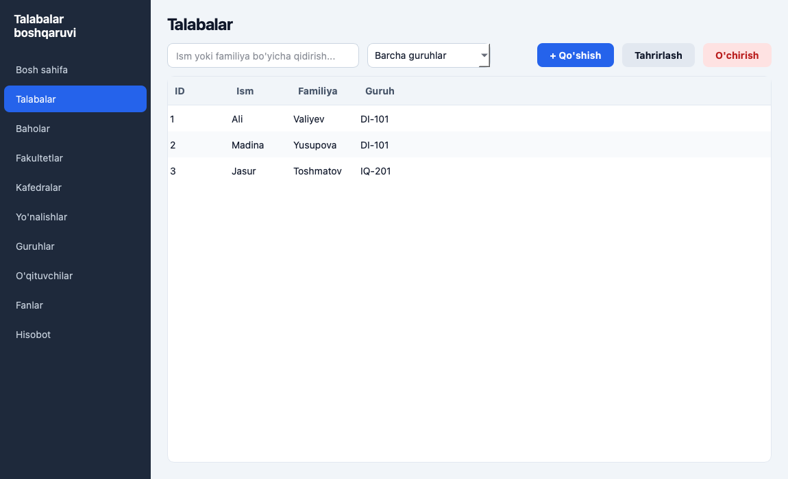

# Talabalar boshqaruvi (PyQt5 + MySQL)

Desktop dastur: talabalar, o'qituvchilar, fakultetlar, guruhlar, fanlar va baholarni boshqarish,
bosh sahifada hisoblagichlar va diagrammalar, hisobotni Excelga eksport qilish.




## Imkoniyatlar
- **Bosh sahifa:** talabalar, o'qituvchilar, fakultetlar, guruhlar soni (`COUNT(*)`) va 2 ta diagramma
- **8 ta jadval:** qo'shish, tahrirlash, o'chirish (o'chirishdan oldin tasdiq so'raladi)
- **Talabalar:** ism/familiya bo'yicha qidiruv va guruh filtri
- **Baholar:** 0–100 ball, 100 dan kattasi rad etiladi
- **Hisobot:** guruh va fan bo'yicha filtr, natijani `.xlsx` ga eksport

## Talablar
- Python 3.10+ (3.13 da tekshirilgan)
- MySQL 8.0.16+ (26.10 da tekshirilgan). Kamida 8.0.16 kerak, chunki ball cheklovi (`CHECK`) shundan boshlab ishlaydi.

## O'rnatish va ishga tushirish

### 1. MySQL (bir marta)
macOS:
```bash
brew install mysql
brew services start mysql
```
Windows/Linux: MySQL ni o'zingizning tizimingiz uchun o'rnating va ishga tushiring.

### 2. Loyiha
```bash
git clone https://github.com/Ismoilkhan22/Desktop_loyiha_odiy.git
cd Desktop_loyiha_odiy

python3 -m venv .venv
source .venv/bin/activate          # Windows: .venv\Scripts\activate
pip install -r requirements.txt

python -m app.init_db              # baza + 8 jadval + namuna ma'lumot
python -m app.main                 # dasturni ochish
```
`init_db` ni qayta ishga tushirish xavfsiz: mavjud ma'lumotni o'chirmaydi.

## MySQL sozlamalari
Default: `localhost:3306`, baza `talaba_db`, foydalanuvchi `root`, **parolsiz**
(Homebrew MySQL shunday ishga tushadi). Sizda boshqacha bo'lsa, muhit o'zgaruvchilari bilan o'zgartiring:
```bash
export DB_USER=root DB_PASSWORD=sirparol DB_HOST=localhost DB_PORT=3306 DB_NAME=talaba_db
```
Parolni kodga yoki GitHub'ga yozmang.

## Muammo bo'lsa
| Xabar | Sabab va yechim |
|-------|-----------------|
| `Can't connect to MySQL server` | MySQL ishlamayapti: `brew services start mysql` |
| `Access denied for user 'root'` | Parol bor: `export DB_PASSWORD=...` |
| Dastur "Bazaga ulanib bo'lmadi" deydi | `python -m app.init_db` bajarilmagan yoki MySQL o'chiq |

## Tekshirish
Alohida test bazada ishlaydi, asosiy ma'lumotga tegmaydi:
```bash
DB_NAME=talaba_test python -m app.init_db
DB_NAME=talaba_test python -m tests.smoke_test      # "Hammasi OK" chiqishi kerak
mysql -uroot -e "drop database talaba_test"         # tozalash
```

## Tuzilma
```
sql/schema.sql, sql/seed.sql   jadvallar va namuna ma'lumot
app/config.py                  baza sozlamasi
app/db.py                      query() va execute()
app/init_db.py                 bazani yaratish
app/style.py                   dizayn (QSS)
app/widgets.py                 diagramma
app/pages/crud.py              universal CRUD sahifa
app/pages/modules.py           8 jadval ta'rifi
app/pages/dashboard.py         bosh sahifa
app/pages/report.py            hisobot + Excel
app/main.py                    asosiy oyna
tests/smoke_test.py            avtomatik tekshiruv
docs/                          topshiriq hujjati va skrinshotlar
```

## Baza sxemasi
```
faculties ─┬─< departments ──< teachers ──< subjects ──┐
           └─< directions ──< student_groups ──< students ──< grades >─┘
```
(`A ──< B` = bitta A ga ko'p B tegishli)

To'liq tushuntirish, qadamlar va kod qayerdaligi: [HISOBOT.md](HISOBOT.md)
